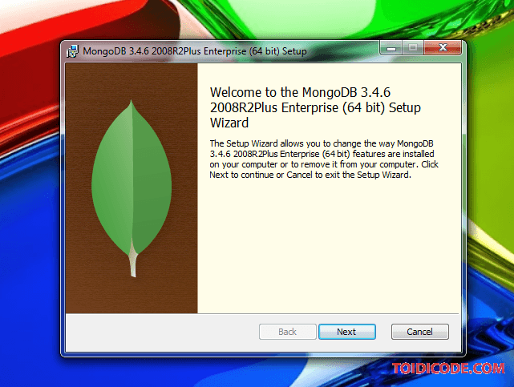
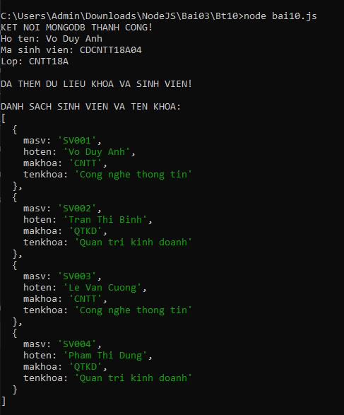

## 1. Các lệnh thực hiện

**Khởi tạo dự án:**

```cmd
cd /d C:\Users\Admin\Downloads\NodeJS\Bai03\Bt10
npm init -y
```

**Cài đặt MongoDB:**

```cmd
npm install mongodb
```

**Chạy chương trình:**

```cmd
node bai10.js
```

## 2. Hình ảnh thực hiện

**Cài đặt thư viện MongoDB:**



**Kết quả chạy chương trình:**

